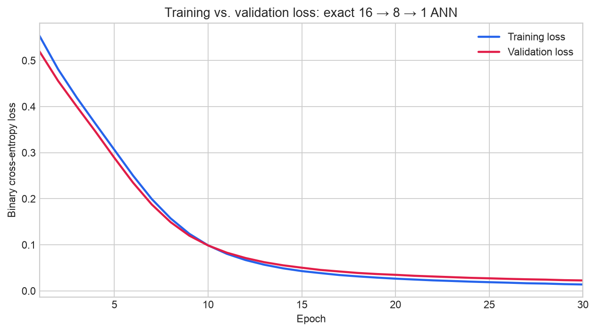

# Build Your First Neural Network: Banknote Authentication

## Problem statement
Build Your First Neural Network — Build a small ANN in Keras with this exact architecture: Dense(16, activation="relu") → Dense(8, activation="relu") → Dense(1, activation="sigmoid"). Compile it with the Adam optimizer and binary_crossentropy loss, split the data into train/test, train for about 30 epochs, and report test accuracy. Plot the training vs. validation loss curve. In 2–3 sentences, explain in your own words what forward propagation and backpropagation are doing each epoch as the model trains.

## Dataset
[Bank Note Authentication UCI data on Kaggle](https://www.kaggle.com/datasets/ritesaluja/bank-note-authentication-uci-data).
Inputs are `variance`, `skewness`, `curtosis` (source column spelling), and
`entropy`; the target is the source's binary `class` label. Source data remains
at Kaggle and is not redistributed in this repository.

## Submission links
- [Public Kaggle notebook](https://www.kaggle.com/code/bhanupriyacn/banknote-first-neural-network)
- [Executed notebook on GitHub](https://github.com/Bhanupriyacn/banknote-first-neural-network/blob/main/banknote_first_neural_network.ipynb)
- Notebook for upload: `banknote_first_neural_network.ipynb`

## Exact architecture and training
```python
model = keras.Sequential([
    keras.Input(shape=(4,)),
    keras.layers.Dense(16, activation="relu"),
    keras.layers.Dense(8, activation="relu"),
    keras.layers.Dense(1, activation="sigmoid"),
])
model.compile(optimizer=keras.optimizers.Adam(learning_rate=0.001),
              loss="binary_crossentropy", metrics=["accuracy"])
history = model.fit(train_ds, validation_data=val_ds, epochs=30)
```

There are 225 trainable parameters and no extra hidden layers. Training uses
batches of 32 and a fixed seed of 42. Exactly 30 epochs complete, with no early
stopping or test-set model selection. Duplicate rows are removed before the
stratified train/validation/test split, and StandardScaler is fitted on training
rows only.

## Executed results
| Measure | Result |
|---|---:|
| Raw rows | 1372 |
| Exact duplicates removed | 24 |
| Unique rows | 1348 |
| Training / validation / test rows | 862 / 216 / 270 |
| Epochs | 30 |
| Test accuracy | 98.89% |
| Correct test predictions | 267 / 270 |
| Test loss | 0.0162 |

These metrics were verified locally using TensorFlow 2.20.0
and Keras 3.11.3. The same notebook also executes on Kaggle;
initialization and numerical operations can differ across library versions and
hardware, so the notebook prints its versions and computes its actual metrics.



## Forward propagation and backpropagation (3 sentences)
During forward propagation, each training batch passes through the two ReLU layers and the sigmoid output to produce predictions, which are compared with the true labels using binary cross-entropy. Backpropagation carries the loss gradient backward through those layers so Adam can update each weight and bias after the batch. An epoch repeats these steps across the training set, then computes validation loss without updating the weights.

## Files and reproduction
- `banknote_first_neural_network.ipynb`: complete executed notebook with the problem statement, exact model,
  all 30 epochs, test results, plot, and explanation.
- `training_history.csv`, `training_validation_loss.png`: all epochs and loss curve.
- `split_summary.csv`, `test_predictions.csv`, `results_summary.json`: evaluation evidence.
- `propagation_explanation.txt`: the three-sentence answer.
- `requirements.txt`: local Python dependencies.

Install `requirements.txt` and run every notebook cell. On Kaggle, attach the
linked dataset; TensorFlow/Keras and the standard analysis libraries are already
available. Locally use `data/banknote_authentication/BankNote_Authentication.csv`
or the loader's public archive fallback when internet is available. Output files
on Kaggle appear under `/kaggle/working/banknote_ann_outputs`. CPU execution is
sufficient; no GPU is needed. Test predictions use the default 0.5 threshold.
